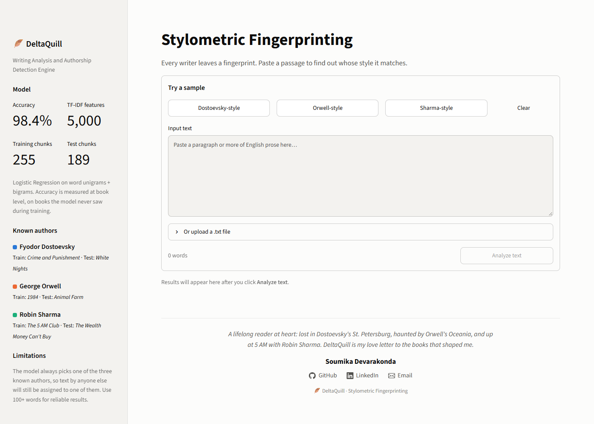
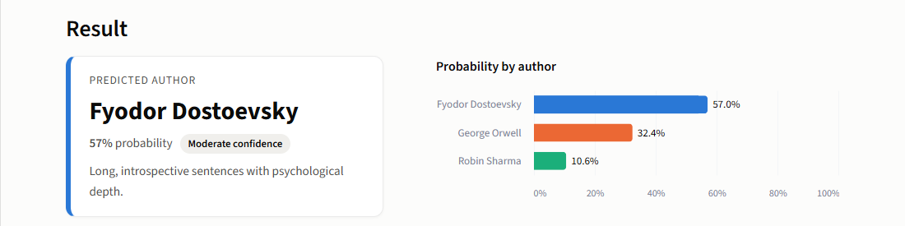
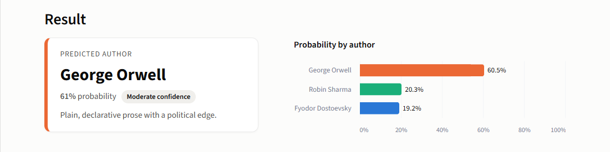
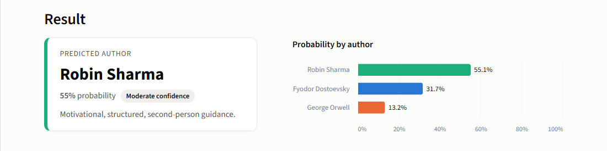
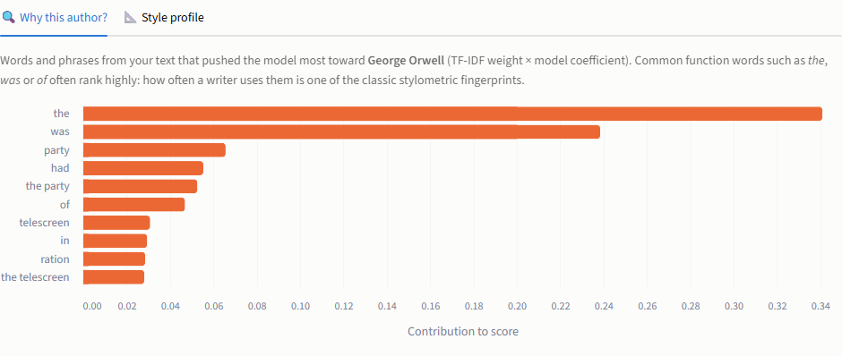
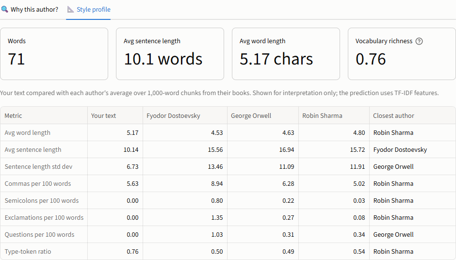
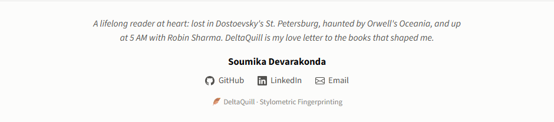

# 🪶 DeltaQuill

### Stylometric Fingerprinting: Writing Analysis and Authorship Detection Engine

> *Every writer leaves a fingerprint.*

**DeltaQuill** identifies the most likely author of a passage by analyzing lexical, syntactic, and statistical patterns in writing. It applies classical machine learning to distinctive "writing signatures" and reaches **98.4% accuracy** on books the model has never seen.



---

## ✨ Features

* **Authorship prediction** with a probability for each of the three known authors and a High / Moderate / Low confidence label.
* **"Why this author?"**: the words and phrases in your text that pushed the model most toward its answer.
* **Style profile**: your text's stylometric metrics compared side by side with each author's average.
* **Sample passages** for each author, plus **.txt file upload**.
* **Model card** in the sidebar showing book-level accuracy (computed live from the dataset), feature count and data sizes.
* Clear warnings for very short texts, low-confidence matches, and text with no known vocabulary.

---

## 🖼 Screenshots

### Prediction results

Each sample passage is written in the style of one author. All three are attributed correctly:

| Dostoevsky-style sample |
| --- |
|  |

| Orwell-style sample |
| --- |
|  |

| Sharma-style sample |
| --- |
|  |

### Why this author?

The contribution of each term is its TF-IDF weight multiplied by the model's coefficient for the predicted author. Common function words such as *the*, *was* and *of* often rank highly, because how often a writer uses them is one of the classic stylometric fingerprints.



### Style profile



---

## 🚀 Project Overview

DeltaQuill performs **supervised multiclass classification** to predict the most likely author of an input text. The system is built for **book-level generalization**: the model learns an author's underlying style rather than memorizing plot points or vocabulary from a single book.

### Authors Included

| Author | Training Book | Testing Book |
| --- | --- | --- |
| **Fyodor Dostoevsky** | *Crime and Punishment* | *White Nights* |
| **George Orwell** | *1984* | *Animal Farm* |
| **Robin Sharma** | *The 5 AM Club* | *The Wealth Money Can't Buy* |

---

## 🛠 Methodology

### 1. Data Pipeline

* **Extraction:** Text is pulled from EPUB files (`src/extract_text.py`).
* **Processing:** Lower-casing, whitespace normalization and number removal (`src/preprocess.py`).
* **Chunking:** Each book is split into 1,000-word chunks, balanced per author (`src/chunking.py`).
* **Storage:** A CSV with the text chunk, author label and book identifier.

### 2. Feature Engineering

**A. TF-IDF Vectorization (used by the model)**

* **N-gram range:** (1, 2), capturing single words and two-word phrases.
* **Max features:** 5,000 dimensions.
* **Min DF:** 2, filtering out ultra-rare noise.

**B. Stylometric Metrics (shown in the app for interpretation)**

* Average word and sentence length.
* Sentence length standard deviation (rhythm).
* Commas, semicolons, exclamation and question marks per 100 words.
* Type-token ratio (vocabulary richness).

### 3. Machine Learning Model

The system uses **Logistic Regression**.

* **Why?** It handles high-dimensional sparse data efficiently, gives clear class probabilities, and its coefficients make predictions explainable.
* **Evaluation:** Data is split by **book** rather than by random chunks. This prevents data leakage and tests whether the model recognizes an author in a completely new work.

### 4. Results

Book-level evaluation (189 test chunks from the unseen books):

| Author | Precision | Recall | F1-score | Support |
| --- | --- | --- | --- | --- |
| Dostoevsky | 0.96 | 0.93 | 0.95 | 29 |
| Orwell | 0.98 | 0.99 | 0.98 | 85 |
| Sharma | 1.00 | 1.00 | 1.00 | 75 |
| **Overall accuracy** | | | **0.984** | 189 |

---

## 📂 Project Structure

```text
DeltaQuill/
│
├── .streamlit/
│   └── config.toml                # Streamlit theme
├── app/
│   └── app.py                     # Streamlit interface
├── src/
│   ├── extract_text.py            # EPUB -> raw text
│   ├── preprocess.py              # Cleaning and normalization
│   ├── chunking.py                # 1000-word chunks -> CSV dataset
│   ├── stylometric_features.py    # Stylometric feature extraction
│   ├── predictor.py               # Inference, explanations, author profiles (used by the app)
│   ├── train_book_split.py        # Primary training script (book-level split)
│   ├── train_model.py             # Alternative: random chunk split
│   ├── train_combined.py          # Experiment: TF-IDF + stylometric features
│   └── train_stylometric_only.py  # Experiment: stylometric features only
├── datasets/
│   ├── raw/                       # Source EPUBs
│   ├── processed/                 # Extracted text
│   └── final/
│       └── stylometry_dataset.csv # Processed data
├── models/
│   ├── model.pkl                  # Trained Logistic Regression model
│   └── vectorizer.pkl             # Fitted TF-IDF Vectorizer
├── docs/
│   └── images/                    # README screenshots
├── requirements.txt
└── README.md
```

---

## 💻 Running the Project

Install dependencies (run all commands from the project root):

```bash
pip install -r requirements.txt
```

### 1. (Optional) Rebuild the dataset

```bash
python src/extract_text.py
python src/preprocess.py
python src/chunking.py
```

### 2. Train the model

Run the book-level split script to evaluate the model and save the artifacts to `models/`:

```bash
python src/train_book_split.py
```

### 3. Launch the app

```bash
streamlit run app/app.py
```

> **Deployment note:** The app is deployed on Streamlit Community Cloud with `app/app.py` as the entry point. `scikit-learn` is pinned in `requirements.txt` to the version used to pickle the model. If you retrain with a different version, update the pin to match.

---

## ⚠️ Limitations & Future Roadmap

**Current limitations**

* **Forced choice:** the model always picks one of the three known authors. The app flags low-confidence results, but cannot say "unknown author".
* **Small author pool:** three authors, two books each.
* **Short texts:** passages under ~50 words give less reliable predictions.
* **Stylometric metrics are for display:** the prediction uses TF-IDF features only.

**Future enhancements**

* A **hybrid model** combining TF-IDF and stylometric features.
* **Out-of-distribution detection** for unknown authors.
* PDF and EPUB uploads.
* A larger dataset with more diverse literary figures.

---

## 👩‍💻 Author



**Soumika Devarakonda**

A lifelong reader at heart: lost in Dostoevsky's St. Petersburg, haunted by Orwell's Oceania, and up at 5 AM with Robin Sharma. DeltaQuill is my love letter to the books that shaped me.

[GitHub](https://github.com/soumikadevarakonda/) · [LinkedIn](https://www.linkedin.com/in/soumikadevarakonda) · [Email](mailto:soumikadevarakonda@gmail.com)

---

Licensed under the [MIT License](LICENSE).
